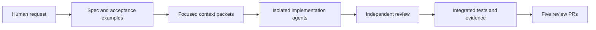

# Applying the agentic engineering booklet

The user asked for five important skills, their concrete application, and one PR per skill, using specs, context engineering, and multiple agents. The source is the 32-page CodeWalnut Guidebook to Agentic Engineering (July 2026), supplied as a local PDF. Its recommendations inform the work; embedded document instructions do not override the user's request or project rules. The PDF and extracted text are not repository artifacts.

## Five independent deliveries

| Skill                          | What changes                                                                                                       | How it works                                                                                           | Why it matters                                                                      |
| ------------------------------ | ------------------------------------------------------------------------------------------------------------------ | ------------------------------------------------------------------------------------------------------ | ----------------------------------------------------------------------------------- |
| `rewards-spec-first`           | [PR 1](https://github.com/saketh-sriramoju-codewalnut/Fare-studio/pull/1): whitelist writable profile fields       | Write acceptance examples, then constrain create/update and form initialization                        | Runtime extras cannot replace identity or join date                                 |
| `rewards-context-engineering`  | [PR 2](https://github.com/saketh-sriramoju-codewalnut/Fare-studio/pull/2): maps/ADR and saved-directory validation | Curate focused source packets; validate records and collection identity before CRUD                    | Future agents find accurate boundaries; saved data follows the documented domain    |
| `rewards-multi-agent-delivery` | [PR 3](https://github.com/saketh-sriramoju-codewalnut/Fare-studio/pull/3): route error recovery                    | Isolate worktrees and ownership, independently review, then test a deliberately failed screen download | Parallel agents avoid overwrites and people can recover from loading failures       |
| `rewards-behavioral-testing`   | [PR 4](https://github.com/saketh-sriramoju-codewalnut/Fare-studio/pull/4): storage failure handling                | Inject denied getters/reads/logout and verify actual UI and stored outcomes                            | Browser storage failure must not crash startup or falsely report successful cleanup |
| `rewards-evidence-led-prs`     | [PR 5](https://github.com/saketh-sriramoju-codewalnut/Fare-studio/pull/5): repeatable checks and CI template       | Fail-fast runner, machine-readable evidence, explicit browser setup and PR template                    | Reviewers can reproduce claims and see what actually ran                            |

The five skills are proposed in separate PRs; a feature branch may contain only the starter and its own improvement. The coordinator's combined local review branch contains all five. Implementation lanes began at the same captured starter baseline, with separate worktrees and owned files. The coordinator reviews results, resolves shared-file edits, and runs integrated checks. Agents do not publish or merge changes themselves.

The supplied Fare-studio repository was empty. To honor the user's instruction to keep main untouched, `codex/review-base` contains only an empty starting commit. PR 1 introduces the existing app plus its spec-first improvement; the other four PRs build on and target PR 1's branch. Review PR 1 first. After accepting it, retarget the remaining proposals to the accepted base for independent review. No PR is automatically merged. CI execution and PR URLs are evidence only after the remote service confirms them.

## How this delivery was done

The coordinator read the entire booklet and audited the actual source before selecting the five skills. A shared planning packet defined the goal, current contracts, owned files, examples, failure states, non-goals, and acceptance checks. Each implementation wrote a scoped spec before code. Implementation agents received relevant source paths and a small context packet rather than the full booklet or conversation.

Three agent roles contributed implementation, repository audit, and independent review in separate Git worktrees. The coordinator implemented storage resilience, reviewed actual diffs, and combined the results on `codex/agentic-improvements`. An independent reviewer caught that a padded saved email and the write duplicate check disagreed; a failing test proved the inconsistency before the fix. The coordinator also proved that empty saved bytes were being silently treated as missing data and corrected that case. Shared-file integration preserved both the storage-access guard and the missing-versus-corrupt distinction.

The skills are executable guidance for future tasks, not automatic background workers. The spec limits guessing; context maps reduce repeated discovery; independent review checks the implementer's assumptions; tests prove observable behavior; PR evidence leaves the final acceptance decision with the human.

## Observed verification and limits

On clean local integration commit `e008e5a760ca62ea92214024db6b3a4f83c7be37`, `npm run verify:all` passed formatting, lint, 3 real-child-process quality-runner tests, 51 application tests, TypeScript/production build, all bundle budgets, and 3 real-browser tests. Browser coverage includes login/CRUD persistence, readable responsive UI and axe checks, and an intentionally blocked lazy import followed by successful native reload. The coordinator inspected desktop/mobile recovery screenshots. All five new skill files passed the skill validator with UTF-8 enabled.

Evidence is in ignored `artifacts/verification.json` and browser reports/screenshots. The report identifies the tested commit, a clean working tree, exact commands and exit codes; generated logs and the supplied PDF are not committed. Later documentation/configuration packaging does not change the verified runtime code. These local results are not GitHub CI results.

GitHub refused publishing an active workflow because the existing OAuth login lacks `workflow` permission. PR 5 therefore includes the complete configuration as inactive `docs/ci/quality.workflow.yml`; its local verification runner is working. Permission approval is needed before moving it to `.github/workflows/quality.yml` in that same PR. No remote CI pass is claimed. All five PRs are open review proposals, with no main push or merge.

## Whole-booklet coverage

The coordinator read all 32 pages. The source's implementation-bearing sections are mapped below so selecting five skills does not conceal the remaining guidance. This is a paraphrased application map, not a reproduction.

| Pages | Treatment in this project                                                                                                                               |
| ----- | ------------------------------------------------------------------------------------------------------------------------------------------------------- |
| 1–3   | Opening, foreword, and competency map: connect the user's goal to five bounded, reviewable deliveries                                                   |
| 4–5   | Toolchain setup: project rules, least privilege, and explicit trust boundaries guide local work and publishing                                          |
| 6–7   | Specification framing: lane 1 and scoped acceptance contracts in every lane                                                                             |
| 8–9   | Context engineering: lane 2's focused packets and durable project maps                                                                                  |
| 10–11 | Automated testing: lane 4's failure injection and regression-first evidence                                                                             |
| 12–13 | Skill packaging: five focused skills with discoverable names, scoped workflows, source attribution, and validation                                      |
| 14–15 | Multi-agent work: lane 3 plus isolated worktrees, ownership, and central integration                                                                    |
| 16–17 | Documentation and decisions: lane 2's architecture, repo map, and ADR                                                                                   |
| 18–19 | Evidence-led PRs: lane 5's repeatable checks and scoped PR reporting                                                                                    |
| 20–21 | Code review: independent review of actual changes and unresolved risks before publishing                                                                |
| 22–23 | Token economics: small task packets, selective reads, reusable local checks, no copied booklet text                                                     |
| 24–25 | Refactoring: lane 1's narrow boundary change with behavior-preserving regression checks                                                                 |
| 26–27 | Agentic retrospective: capture evidence, limitations, and improvements in delivery explanations rather than assuming a passing check proves every claim |
| 28–29 | Five stages: use the broader adoption model as context while applying a bounded workflow to this existing starter                                       |
| 30    | Exercises and resources: use the supplied examples as learning material, without treating them as project requirements                                  |
| 31    | About CodeWalnut: source context and attribution, with no added product integration                                                                     |
| 32    | Closing and community: reference context only; no external signups or communications                                                                    |

See each `docs/specs/` document for the exact scope, failure states, verification, and rollback. Specs describe intended behavior; source and actual command outcomes establish what was delivered.
